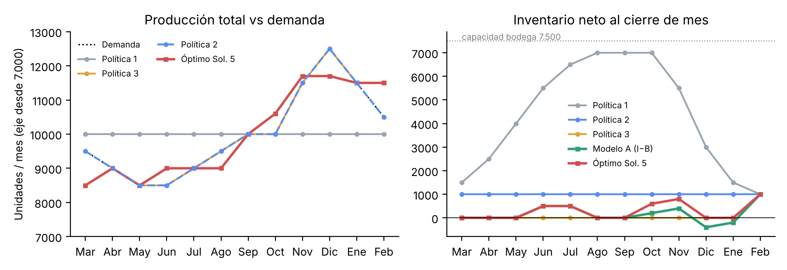
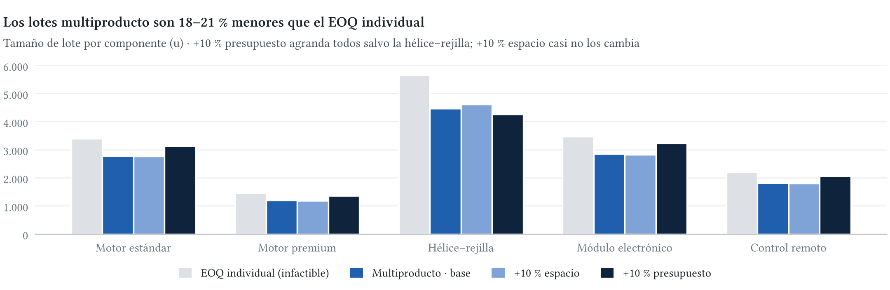

**Respaldo reproducible.** Todo resultado de este informe se regenera con `python proyecto/01_codigo/run_all.py` (PuLP 2.9 + CBC; SciPy para verificación). La planilla `02_resultados/Resultados_Ventisur.xlsx` recalcula con fórmulas propias balances, capacidades, costos, EOQ y uso de recursos a partir de las decisiones; los modelos exportados están en `02_resultados/modelos_lp/`. Costos en pesos chilenos; MM\$ = millones.

# Parte I — Planificación agregada

## Solicitud 1. Políticas simples

| | Política 1: tasa constante | Política 2: dotación constante + HE | Política 3: persecución (solo regular) |
|---|---|---|---|
| Regla | 20 trab., 10.000 u/mes regulares | 20 trab., producir $d_t$ (regular, luego HE), $I_t=1.000$ | $W_t=\lceil (d_t+I^{obj}_t-I_{t-1})/500\rceil$, $I_t=0$ salvo feb. (1.000) |
| Mecanismo de ajuste | Inventario | Horas extra (y capacidad ociosa) | Contratación/despido |
| Dotación | 20 fija | 20 fija | 17–25 (9 contrat., 6 desp.) |
| Horas extra | 0 | 6.000 u (nov–feb) | 0 |
| Inventario máx. / acumulado | 7.000 / 52.000 u-mes | 1.000 / 12.000 u-mes | 1.000 / 1.000 u-mes |
| Costo laboral | 288,0 | 288,0 | 288,0 |
| Contratación + despido | 0 | 0 | 22,5 + 18,0 |
| Horas extra | 0 | 15,0 | 0 |
| Inventario | 52,0 | 12,0 | 1,0 |
| **Costo total (MM\$)** | **340,0** | **315,0** | **329,5** |

| Mes | Mar | Abr | May | Jun | Jul | Ago | Sep | Oct | Nov | Dic | Ene | Feb |
|---|---|---|---|---|---|---|---|---|---|---|---|---|
| $d_t$ | 9.500 | 9.000 | 8.500 | 8.500 | 9.000 | 9.500 | 10.000 | 10.000 | 11.500 | 12.500 | 11.500 | 10.500 |
| P1: $I_t$ ($W$=20, $R$=10.000) | 1.500 | 2.500 | 4.000 | 5.500 | 6.500 | 7.000 | 7.000 | 7.000 | 5.500 | 3.000 | 1.500 | 1.000 |
| P2: $R_t$ ($W$=20, $I_t$=1.000) | 9.500 | 9.000 | 8.500 | 8.500 | 9.000 | 9.500 | 10.000 | 10.000 | 10.000 | 10.000 | 10.000 | 10.000 |
| P2: $O_t$ | 0 | 0 | 0 | 0 | 0 | 0 | 0 | 0 | 1.500 | 2.500 | 1.500 | 500 |
| P3: $W_t$ ($H_t$/$F_t$) | 17 (−3) | 18 (+1) | 17 (−1) | 17 | 18 (+1) | 19 (+1) | 20 (+1) | 20 | 23 (+3) | 25 (+2) | 23 (−2) | 23 |
| P3: $R_t$ ($I_t$=0 salvo feb.) | 8.500 | 9.000 | 8.500 | 8.500 | 9.000 | 9.500 | 10.000 | 10.000 | 11.500 | 12.500 | 11.500 | 11.500 |

Las tres políticas son factibles: respetan bodega (≤7.500), dotación 15–25, ±3 trabajadores/mes, $I_0=I_{12}=1.000$ y cero pendientes (validado en código y en la hoja *Chequeos* del Excel). En P3 la dotación entera cubre exactamente la demanda neta cada mes (marzo usa el inventario inicial: 9.500−1.000 = 8.500 = 17×500) y las cotas de ±3 se alcanzan justo en marzo (−3) y noviembre (+3), y el máximo de 25 en diciembre, sin impedir seguir la demanda (la regla es miope: con otros datos habría que contratar antes).

**Comparación.** Las tres pagan la misma masa laboral (288 MM\$ = 240 trabajador-mes; en P3 los 240 trabajador-mes se redistribuyen en el año), por lo que la diferencia está *solo* en el mecanismo de ajuste. **P1** (estrategia de nivelación) es la más simple y estable para proveedores y personal, pero acumula hasta 7.000 u en bodega (93 % de su capacidad) y cada unidad que espera de mayo a diciembre paga \$1.000/mes: es la más cara. **P2** (mixta) mantiene la dotación y absorbe el peak con HE a \$2.500/u; es la mejor de las simples porque cada unidad de HE cuesta menos que 2,5 meses de mantención, pero deja 6.000 u de capacidad regular ociosa en marzo–agosto y usa en diciembre el 83 % de la capacidad de HE (2.500/3.000). **P3** (persecución) casi elimina el inventario y no usa HE, pero sus 9 contrataciones y 6 despidos (40,5 MM\$) cuestan más que lo que ahorra frente a P2 (11 MM\$ de inventario + 15 MM\$ de HE), además de generar inestabilidad laboral (rotación de 15 movimientos) y aprendizaje. *Anticipación:* si el costo de mantener subiera, P1 empeora linealmente (52.000 u-mes); si el de HE superara \$4.917/u (29,5 MM\$ / 6.000 u), P2 dejaría de superar a P3.

## Solicitud 2. Modelo A: formulación

**Índices y conjuntos.** $t=1,\dots,12$ (marzo…febrero). **Parámetros:** $d_t$ demanda; $W_0=20$; $I_0=1.000$; $B_0=0$; $a=500$, $e=150$ (u/trab-mes regular y HE); $c^W=1\text{,}2$ MM, $c^H=2\text{,}5$ MM, $c^F=3$ MM, $c^O=2.500$, $h=1.000$, $b=750$; $\bar I=7.500$; $\underline W=15$, $\overline W=25$; $\overline H=\overline F=3$; $I^{fin}=1.000$.

**Variables.** $W_t\in\mathbb Z_+$ trabajadores disponibles en $t$; $H_t,F_t\in\mathbb Z_+$ contratados/despedidos al inicio de $t$; $R_t\ge0$ unidades en tiempo regular; $O_t\ge0$ unidades en HE; $I_t\ge0$ inventario al cierre; $B_t\ge0$ pedidos pendientes (demanda aceptada no entregada) al cierre. Las variables de personas son enteras (no se contrata una fracción); la producción se trata como continua (volúmenes de miles de unidades).

$$\min Z=\sum_{t=1}^{12}\left(c^W W_t+c^H H_t+c^F F_t+c^O O_t+h\,I_t+b\,B_t\right)$$
sujeto a, $\forall t$:

| Restricción | Propósito en Ventisur |
|---|---|
| $W_t=W_{t-1}+H_t-F_t$ | Evolución de la dotación (conecta los meses) |
| $R_t\le a\,W_t$;  $O_t\le e\,W_t$ | Capacidad regular y de HE dependen de la dotación; capacidades independientes |
| $I_{t-1}-B_{t-1}+R_t+O_t-d_t=I_t-B_t$ | Balance de inventario neto: lo disponible menos la demanda queda en bodega o como pendiente |
| $I_t\le 7.500$ | Capacidad de bodega de producto terminado |
| $15\le W_t\le25$; $H_t\le3$; $F_t\le3$ | Políticas de dotación y de movimientos de personal |
| $I_{12}\ge1.000$; $B_{12}=0$; $W_0,I_0,B_0$ dados | Condiciones de borde: el horizonte no "consume" el inventario de seguridad ni traspasa deuda con clientes |

**Función objetivo.** Incluye todos los costos que *cambian* entre planes. El costo laboral se paga por trabajador disponible aunque no produzca, por eso multiplica $W_t$ y no $R_t$: la producción regular no tiene costo variable propio. No es necesario imponer que la HE se use solo tras agotar la regular: como la regular ya está pagada y la HE cuesta \$2.500/u, el modelo nunca prefiere HE si hay capacidad regular útil.

## Solicitud 2. Modelo A: solución e interpretación — **Z = 300,75 MM\$**

| Mes | Mar | Abr | May | Jun | Jul | Ago | Sep | Oct | Nov | Dic | Ene | Feb |
|---|---|---|---|---|---|---|---|---|---|---|---|---|
| $W_t$ (desp.) | 18 (−2) | 18 | 18 | 18 | 18 | 18 | 18 | 18 | 18 | 18 | 18 | 18 |
| $R_t$ | 8.500 | 9.000 | 8.500 | 9.000 | 9.000 | 9.000 | 9.000 | 9.000 | 9.000 | 9.000 | 9.000 | 9.000 |
| $O_t$ | 0 | 0 | 0 | 0 | 0 | 0 | 1.000 | 1.200 | 2.700 | 2.700 | 2.700 | 2.700 |
| $I_t$ / $B_t$ | 0 | 0 | 0 | 500 | 500 | 0 | 0 | 200 | 400 | 0 / **400** | 0 / **200** | 1.000 |

Costos: laboral 259,2; despido 6,0; HE 32,5 (13.000 u); inventario 2,6; pendientes 0,45 MM\$. El modelo **despide 2 trabajadores en marzo y mantiene 18 todo el año**: conservar un trabajador cuesta 14,4 MM\$/año (11,4 netos del despido evitado), pero su capacidad solo hace falta de septiembre a febrero; cubrir esas ~3.000 u con HE cuesta ≈7,5 MM\$. Mantener a un trabajador solo convendría si se usara ≈11,5 meses al año. Luego combina tres mecanismos que las políticas simples usaban por separado: (i) **HE** desde septiembre, saturada (2.700 = 150×18) de noviembre a febrero; (ii) **inventario anticipado corto** (junio–julio para agosto, octubre–noviembre para el peak), porque mantener 1–2 meses (\$1.000–2.000) es más barato que una HE (\$2.500), pero 3 o más meses no lo es; por eso hay capacidad regular ociosa en marzo y mayo (1.000 u) aunque luego se pague HE; (iii) **pedidos pendientes** en diciembre–enero, ya que postergar una unidad un mes (\$750) es más barato que fabricarla antes y guardarla (\$1.000/mes). Mejora 14,25 MM\$ (−4,5 %) sobre la mejor política simple (P2).

**Comportamientos contraintuitivos.** Despedir en marzo para luego operar con HE al 100 % en el peak; dejar capacidad regular ociosa mientras se pagan HE meses después; y aceptar atrasos con clientes aun teniendo inventario dos meses antes. Todo se explica porque $b<h$: atrasar es más barato que adelantar. La relajación lineal (personas continuas) vale 300,68 MM\$: la integralidad cuesta solo 0,07 MM\$. Puede haber óptimos alternativos con igual $Z$ (p. ej., otra distribución de HE entre meses); el modelo exige $I_{12}\ge1.000$, que en el óptimo se cumple con igualdad.

## Solicitud 3. Modelo B: multa contractual — **Z = 300,94 MM\$**

Se agrega $y_t\in\{0,1\}$ (=1 si en el mes $t$ se paga la multa) y:
$$B_t\le 0\text{,}01\,d_t+M_t\,y_t\quad\forall t,\qquad Z_B=Z_A+\sum_t 3.000.000\,y_t .$$
Si $B_t>0\text{,}01d_t$ la restricción obliga $y_t=1$; si $B_t\le0\text{,}01d_t$ el modelo elige $y_t=0$ porque la multa es costosa (no hace falta forzar el caso contrario). **Constante:** $M_t$ debe ser una cota de $B_t-0\text{,}01d_t$ que no elimine soluciones factibles; usamos $M_t=\sum_{k\le t}d_k-I_0-0\text{,}01d_t$ (peor caso: no producir nada hasta $t$, lo que es factible porque $R_t$ puede ser 0; vale para planes sin $I_t$ y $B_t$ positivos a la vez, lo que siempre ocurre en el óptimo). Un $M$ demasiado chico cortaría planes válidos; uno exageradamente grande debilita la relajación lineal y la estabilidad numérica.

**Resultado.** Ninguna multa se activa: el modelo recorta los pendientes de diciembre de 400 a **125 u (exactamente el 1 % de 12.500)** y elimina los de enero, compensando con más HE en octubre (1.475) e inventario en octubre–noviembre (475 y 675 u). La dotación (18) no cambia. Pagar una multa (\$3 MM) nunca conviene: eliminar 400 u de atraso cuesta como máximo unos cientos de miles de pesos. Costo adicional: **+0,19 MM\$** frente a A.

## Solicitud 4. Modelo C: cero pendientes — **Z = 301,10 MM\$**

Al Modelo A se agrega $B_t=0\ \forall t$ (equivale a eliminar $B_t$ del balance y de la FO). La solución mantiene 18 trabajadores, las mismas 13.000 u de HE y adelanta producción: HE en octubre sube a 1.600 y el inventario de octubre–noviembre a 600 y 800 u para cubrir diciembre, donde la capacidad (9.000 + 2.700 = 11.700) es menor a la demanda (12.500).

| | A | B | C |
|---|---|---|---|
| Costo total (MM\$) | 300,75 | 300,94 | 301,10 |
| Dotación / despidos | 18 / 2 | 18 / 2 | 18 / 2 |
| HE (u) / inventario acumulado (u-mes) | 13.000 / 2.600 | 13.000 / 3.150 | 13.000 / 3.400 |
| Pendientes (u-mes) / máximo mensual | 600 / 400 (3,2 % dic.) | 125 / 125 (1 %) | 0 / 0 |
| Demanda atendida a tiempo (anual) | 99,5 % | 99,9 % | 100 % |
| **Costo de elevar el servicio vs A** | — | **+193.750** | **+350.000 (0,12 %)** |

Lo que se compra con 350 mil pesos es cambiar 600 u-mes de atraso por 800 u-mes adicionales de inventario: cada unidad de pendiente "desaparece" al ser fabricada antes y guardada. Como el sistema ya trabaja al máximo de HE en el peak, la única palanca disponible es anticipar inventario.

## Solicitud 5. Multa + cero pendientes y recomendación — **Z = 301,10 MM\$**

Al Modelo B se agrega $B_t=0$. Entonces $B_t=0\le0\text{,}01d_t$ se cumple siempre con $y_t=0$, la multa nunca se activa y el modelo **coincide con C** (mismo plan, 301,10 MM\$): con servicio completo, la cláusula contractual deja de ser una restricción relevante.

**Recomendación.** Adoptar el plan de cero pendientes (Sol. 5): (1) cuesta solo 0,35 MM\$ (0,12 %) más que el óptimo con atrasos y elimina el riesgo contractual y reputacional con los clientes principales (el plan A habría gatillado multas en diciembre y enero: 400 > 125 y 200 > 115); (2) es 13,9 MM\$ (4,4 %) más barato que la mejor política simple; (3) es **estable**: un solo ajuste de personal (−2 en marzo) y producción regular casi plana (9.000 u; 8.500 en marzo y mayo); (4) usa poco inventario (máx. 1.000 u, 13 % de la bodega). *Trade-off principal:* la HE queda al 100 % de su capacidad en noviembre y diciembre (93 % en enero y febrero), sin holgura ante un pronóstico que se quede corto. Lo cuantificamos (hoja *Sensibilidad_P1*): mantener **19 trabajadores** (despedir 1) cuesta 302,5 MM\$ (+1,4 MM\$, +0,46 %) y reduce la HE a 9.500 u, dejando 700–850 u/mes de holgura en noviembre, enero y febrero (diciembre sigue al 100 %); limitar la HE al 80 % cuesta 303,1 MM\$; no despedir (20) cuesta 306,5 MM\$. Sugerimos el plan de 18 trabajadores como base y la variante de 19 como seguro si la Gerencia percibe alta incertidumbre en la demanda de fin de año. *Supuestos:* demanda determinística, unidad agregada homogénea, productividad constante; si la HE se encarece 20 % el óptimo pasa a 18→19 trabajadores en septiembre (307,1 MM\$).

{width=100%}

# Parte II — De la producción a los requerimientos de materiales

## Solicitud 6

Con la tasa oficial de 10.000 u/mes y la mezcla 50–30–20: Estándar 5.000 u/mes (60.000/año), Plus 3.000 (36.000), Premium 2.000 (24.000). Aplicando la lista de materiales, $r_j=\sum_m u_{jm}\,P_m$:

| Componente | Usado por | Mensual | Anual |
|---|---|---|---|
| Motor estándar | Estándar + Plus | 5.000 + 3.000 = 8.000 | 96.000 |
| Motor premium | Premium | 2.000 | 24.000 |
| Conjunto hélice–rejilla | los tres | 10.000 | 120.000 |
| Módulo electrónico | Plus + Premium | 3.000 + 2.000 = 5.000 | 60.000 |
| Control remoto | Premium | 2.000 | 24.000 |

Coinciden con los valores oficiales. Estas cifras son **tasas de consumo**, no tamaños de pedido ni calendario de compras: dicen *cuánto se consume por mes*, mientras que *cuánto y cuándo pedir* lo decide la Parte III. Pueden tratarse como constantes porque (i) la Gerencia fijó una tasa de producción agregada estable (10.000/mes, la lógica de la Política 1), (ii) la mezcla se supone fija, (iii) la lista de materiales es fija y (iv) la producción se reparte de forma pareja en los días operativos. Además, se apoya en supuestos de la planificación agregada: unidad agregada homogénea (una unidad de cualquier modelo usa la misma capacidad), demanda determinística y una mezcla que no cambia entre meses. **Conexión con la Parte I:** el plan de costo mínimo hace variar la producción entre 8.500 y 11.700 u/mes; si se usara ese plan, el consumo de componentes no sería constante y el EOQ clásico sería solo una aproximación. La Gerencia acepta la tasa estable a cambio de coordinación simple con proveedores, que es precisamente la ventaja de la Política 1.

# Parte III — Inventarios determinísticos

## Solicitudes 7 y 8. EOQ individuales y factibilidad conjunta

$h_i=0\text{,}25c_i$; $Q_i^*=\sqrt{2D_iS_i/h_i}$; $N_i=D_i/Q_i^*$; $T_i=Q_i^*/d_i$ (días); $d_i=D_i/240$; $ROP_i=d_iL_i$; costo relevante $=D_iS_i/Q_i+h_iQ_i/2$.

| Componente | $h_i$ | $Q_i^*$ | $N_i$ | $T_i$ (días) | $d_i$ (u/día) | $L_i$ | ROP | Costo relevante | $v_iQ_i$ (m³) | $c_iQ_i$ (MM\$) |
|---|---|---|---|---|---|---|---|---|---|---|
| Motor estándar | 3.000 | 3.394 | 28,3 | 8,5 | 400 | 6 | 2.400 | 10.182.338 | 13,58 | 40,73 |
| Motor premium | 5.000 | 1.453 | 16,5 | 14,5 | 100 | 10 | 1.000 | 7.266.361 | 7,27 | 29,07 |
| Hélice–rejilla | 1.125 | 5.657 | 21,2 | 11,3 | 500 | 8 | 4.000 | 6.363.961 | 84,85 | 25,46 |
| Módulo electrónico | 2.000 | 3.464 | 17,3 | 13,9 | 250 | 10 | 2.500 | 6.928.203 | 5,20 | 27,71 |
| Control remoto | 1.375 | 2.211 | 10,9 | 22,1 | 100 | 12 | 1.200 | 3.039.737 | 2,21 | 12,16 |
| **Total** | | | 94,2 | | | | | **33.780.600** | **113,10** | **135,12** |

**Política.** $Q^*$ responde *cuánto* pedir: equilibra el costo de ordenar (baja con lotes grandes) y el de mantener (sube con lotes grandes); en el óptimo ambos son iguales. El ROP responde *cuándo*: al llegar el inventario a $d_iL_i$ se emite la orden y, con demanda y plazo conocidos, el lote llega justo cuando el stock se agota (sin stock de seguridad). Ej.: "pedir 3.394 motores estándar cuando queden 2.400 (6 días de consumo), unas 28 veces al año, cada 8,5 días operativos". Como $L_i<T_i$ en todos los casos, nunca hay más de un pedido en tránsito y el ROP sobre inventario físico coincide con el de la posición de inventario; el plazo de entrega solo mueve el *cuándo*, no el *cuánto*. **Supuestos** del EOQ: demanda conocida y constante (garantizada por la tasa estable y la mezcla fija de la Parte II), plazo constante, reposición instantánea del lote completo, sin quiebres, sin descuentos por cantidad y costos $S,h$ constantes.

**Factibilidad conjunta.** Si todos los lotes estuvieran completos a la vez (criterio de Sesión 4, conservador), los EOQ requieren **113,10 m³ > 90** (exceso 23,1 m³; la hélice–rejilla sola usa 84,85 m³, el 94 % del espacio) y **135,12 MM\$ > 110 MM\$** (exceso 25,1 MM\$; los motores usan 69,8 MM\$). **Ambas restricciones se violan**: cada EOQ es óptimo mirando solo su propio trade-off y "ignora" que compite con los demás por la bodega y el capital; la suma de óptimos individuales no tiene por qué caber en recursos compartidos.

## Solicitud 9. EOQ multiproducto restringido

**Variables:** $Q_i>0$, tamaño de lote del componente $i$. Las restricciones reservan espacio y capital para **lotes completos** ($v_iQ_i$, $c_iQ_i$), como pide "valor total de los lotes" y como en Sesión 4; si se midieran sobre el inventario promedio ($Q_i/2$), los EOQ usarían 56,6 m³ y 67,6 MM\$ y serían factibles. **Modelo (no lineal, convexo, por lo que KKT entrega el óptimo global):**
$$\min\ \sum_i\left(\frac{D_iS_i}{Q_i}+\frac{h_iQ_i}{2}\right)\quad\text{s.a.}\quad \sum_i v_iQ_i\le 90\ \ (\mu),\qquad \sum_i c_iQ_i\le 110.000.000\ \ (\lambda),\qquad Q_i>0.$$
Por KKT, $Q_i=\sqrt{2D_iS_i/(h_i+2\mu v_i+2\lambda c_i)}$ con $\mu,\lambda\ge0$ y holgura complementaria: cada recurso escaso actúa como un "costo de mantener adicional" proporcional a lo que el componente consume de él (el factor 2 aparece porque la mantención se cobra sobre $Q_i/2$ y los recursos sobre $Q_i$ completo). Se resolvió por bisección sobre $(\mu,\lambda)$ y se verificó con SLSQP (mismo óptimo). **El costo de compra $\sum_iD_ic_i$ (2.784 MM\$/año) no depende de $Q_i$**: se compra la misma cantidad anual con cualquier tamaño de lote, así que es una constante que no cambia el óptimo; solo importaría con descuentos por cantidad. El precio sí entra en la restricción de capital y en $h_i$.

| Componente | $Q_i$ | vs EOQ | $N_i$ | $T_i$ (días) | ROP | Costo relevante |
|---|---|---|---|---|---|---|
| Motor estándar | 2.781 | −18,1 % | 34,5 | 6,95 | 2.400 | 10.385.094 |
| Motor premium | 1.192 | −18,0 % | 20,1 | 11,9 | 1.000 | 7.409.393 |
| Hélice–rejilla | 4.456 | −21,2 % | 26,9 | 8,9 | 4.000 | 6.546.129 |
| Módulo electrónico | 2.844 | −17,9 % | 21,1 | 11,4 | 2.500 | 7.063.396 |
| Control remoto | 1.815 | −17,9 % | 13,2 | 18,2 | 1.200 | 3.099.005 |
| **Total** | | | **115,9** | | | **34.503.017** |

Ambas restricciones quedan **activas** (90,0 m³ y 110,0 MM\$ exactos), con $\mu=5.098$ \$/m³-año y $\lambda=0\text{,}0595$ \$/\$-año. Todos los lotes se achican y se pide más seguido (94 → 116 pedidos/año): sube el costo de ordenar y baja el de mantener; el costo relevante aumenta 0,72 MM\$/año (+2,1 %) respecto del EOQ (infactible). La hélice–rejilla, gran consumidora de espacio, se reduce más (−21 %); los demás ≈ −18 % por el capital. Una restricción **activa** significa que se usa completa y que el óptimo "querría" más de ese recurso: su multiplicador es el ahorro anual por unidad adicional de recurso. El ROP no cambia ($d_iL_i$), pero ahora $T_i$ queda muy cerca de $L_i$ (hélice–rejilla 8,9 vs 8 días; 8,5 vs 8 con +10 % de presupuesto): si los lotes se achicaran más, habría pedidos en tránsito y el ROP debería aplicarse sobre la posición de inventario.

## Solicitud 10. Sensibilidad y recomendación

| Escenario | Espacio usado | Capital usado | ¿Activas? | $\mu$ | $\lambda$ | Costo relevante | Ahorro vs base |
|---|---|---|---|---|---|---|---|
| Base (90 m³; 110 MM\$) | 90,0 | 110,0 | ambas | 5.098 | 0,0595 | 34.503.017 | — |
| a) +10 % espacio (99 m³) | 92,1 (holgura 6,9) | 110,0 | solo capital | 0 | 0,0636 | 34.497.798 | **5.219** |
| b) +10 % presupuesto (121 MM\$) | 90,0 | 121,0 | ambas | 24.785 | 0,0135 | 34.116.426 | **386.591** |

**a)** Con más bodega, el capital se vuelve el único límite: con solo la restricción de capital todos los lotes se escalan igual (−18,6 % vs EOQ, porque la tasa de mantención es común) y ocupan 92,07 m³, así que de los 9 m³ extra solo se aprovechan 2,07 y el resto queda ocioso. Los lotes casi no cambian (hélice +3,4 %, el resto entre −0,6 y −0,9 %). **b)** Con más presupuesto todos los lotes crecen (+12,6 % a +13,9 %), excepto la hélice (−4,5 %), que cede espacio a los demás porque la bodega sigue llena; $\mu$ sube (el espacio se vuelve más valioso) y $\lambda$ cae (rendimientos decrecientes). **Recomendación:** si hay que elegir, **ampliar el presupuesto** genera 74 veces más valor que ampliar el espacio. Que ambas restricciones estén activas no implica que relajarlas valga lo mismo: el multiplicador es un valor marginal *local* (estimaría 5.098×9 = 45.881, nueve veces el ahorro real, y 0,0595×11 MM = 654.421, 1,7 veces el real; aun así ya anticipa una ventaja de 14 a 1 para el presupuesto) y cambia al relajar, porque al aumentar el espacio el capital pasa a limitar casi de inmediato, mientras que el capital extra se aprovecha completo. Un recurso puede ser "activo" y aun así tener poco valor económico si otro recurso está a punto de limitar.

{width=100%}

# Recomendación final integrada

1. **Planificación agregada:** operar con **18 trabajadores** (ajuste único de −2 en marzo), producción regular nivelada de ~9.000 u/mes y HE de septiembre a febrero, **sin pedidos pendientes** (Sol. 5: 301,1 MM\$). Costo 4,4 % menor que la mejor regla simple, servicio completo y bajo inventario; el riesgo es la HE saturada en el peak, que se mitiga en parte con 19 trabajadores por 1,4 MM\$ adicionales. El costo de pasar a servicio completo (0,35 MM\$) es muy bajo frente a una sola multa (3 MM\$).
2. **Coherencia entre decisiones:** el abastecimiento se planifica con la tasa estable de 10.000 u/mes. El plan agregado óptimo no es plano (8.500–11.700 u/mes), por lo que Ventisur debe revisar los lotes o contar con holgura de componentes en el peak (oct–feb), cuando la producción supera la tasa usada para comprar.
3. **Inventarios:** implementar los lotes del EOQ multiproducto (2.781 / 1.192 / 4.456 / 2.844 / 1.815) con los ROP de la tabla, no los EOQ individuales, que no caben ni en la bodega ni en el presupuesto. El sobrecosto por las restricciones (0,72 MM\$/año) es pequeño frente al costo de compra (2.784 MM\$/año).
4. **Inversión:** priorizar **más presupuesto para lotes** sobre más bodega (ahorro 386.591 vs 5.219 \$/año). Los 386.591 \$/año equivalen a una rentabilidad *media* de 3,5 % anual sobre los 11 MM\$ (la marginal parte en 5,95 % y cae a 1,35 %). Como $h_i$ ya incluye el costo de capital, ese 3,5 % es un beneficio neto adicional: conviene ampliar si el tope de 110 MM\$ responde a una restricción de caja que puede levantarse sin otros costos.

*Limitaciones:* demanda y plazos determinísticos (sin stock de seguridad, por indicación del curso), unidad agregada homogénea y lotes con reserva de espacio para todos los lotes completos al mismo tiempo (si se escalonan las llegadas, el espacio efectivo requerido es menor).
